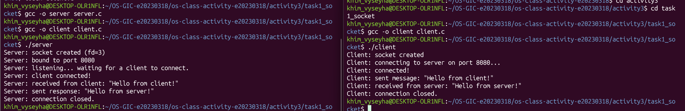
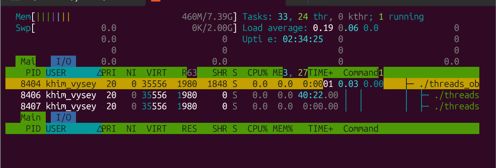
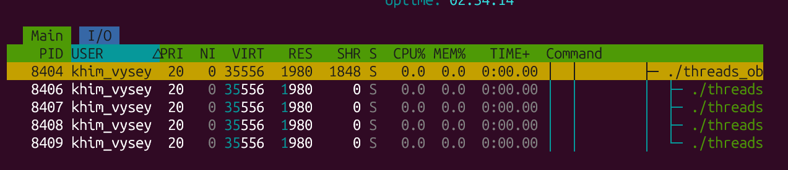

# Class Activity 3 — Socket Communication & Multithreading

- **Student Name:** Khim Vyseyha
- **Student ID:** e20230318
- **Date:** 16 November 2026

---

## Task 1: TCP Socket Communication (C)

### Compilation & Execution

### Answers

1. **Role of `bind()` / Why client doesn't call it:**
   The bind() function associates the server's socket with a specific IP address and port number so that incoming client connections know exactly where to find the service. The client does not need to call bind() because the operating system automatically assigns it a random, available "ephemeral" port when it calls connect(). The server doesn't care what port the client uses, but the client must know the server's exact port to establish the connection.

2. **What `accept()` returns:**
   The accept() function returns a new socket file descriptor (an integer) that is specifically linked to the client that just connected. The original server socket (created with socket()) remains open and continues listening for new, additional incoming connections, while the new socket returned by accept() is used exclusively to read and write data with that specific connected client.

3. **Starting client before server:**
   If you start the client before the server, the connect() system call fails and the program terminates with a "connect: Connection refused" error. This happens because the operating system checks the target port (8080) and sees that there is no server process currently bound to it and actively listening to accept the TCP handshake.

4. **What `htons()` does:**
   htons() stands for "host to network short". It translates the port number from the host computer's native byte order (which is usually little-endian on modern processors) into network byte order (big-endian). This conversion is strictly required because different computer architectures store multi-byte integers differently; enforcing a standard network byte order ensures that both the sender and receiver correctly interpret the port and IP address regardless of their hardware.

5. **Socket call sequence diagram:**
SERVER                              CLIENT
------                              ------
socket()
   |
bind()
   |
listen()
   |
accept()  <====== Connection ======>   socket()
   |                                      |
   |                                   connect()
   |                                      |
read()    <====== Request ========   send/write()
   |                                      |
send()    ====== Response =======>   read/recv()
   |                                      |
close()   <===== Disconnect ======>    close()

## Task 2: POSIX Threads (C)

### Output — Without Mutex (Race Condition)

### Output — With Mutex (Correct)

Main thread (TID: 136017086613312): creating 4 threads (with mutex)...
Thread 1 (TID: 136017082316480): starting work...
Thread 2 (TID: 136017073923776): starting work...
Thread 3 (TID: 136017065531072): starting work...
Thread 1 (TID: 136017082316480): done.
Thread 3 (TID: 136017065531072): done.
Thread 4 (TID: 136017057138368): starting work...
Thread 4 (TID: 136017057138368): done.
Thread 2 (TID: 136017073923776): done.

All threads completed.
Expected counter value: 400000
Actual counter value:   400000
✅ Counter is correct! Mutex prevented the race condition.

### Answers

1. **What is a race condition?**
   A race condition occurs when multiple threads access and modify shared data at the same time, and the final result depends on the unpredictable timing of the OS scheduler. In threads.c, the operation shared_counter++ is not atomic; it actually takes three steps at the CPU level: read the value, increment it, and write it back. Because the threads aren't synchronized, they read the same old value, increment it, and overwrite each other's work, causing many increments to be lost and resulting in a completely incorrect final count.

2. **What does `pthread_mutex_lock()` do?**
   The pthread_mutex_lock() function acquires an exclusive lock on a mutual exclusion (mutex) object. If another thread already holds the lock, the current thread will pause and wait until it is unlocked. It fixes the race condition by turning the counter increment into a "critical section"—guaranteeing that only one thread can read, increment, and write to the shared_counter at any given time, preventing the threads from stepping on each other's toes.

3. **Removing `pthread_join()`:**
   If you forget to call pthread_join(), the main thread will not wait for the worker threads to finish. It will rush straight to the end of the main() function, print the final output immediately (which will likely be 0 or a very low number), and then exit the program. When the main process exits, the operating system instantly kills all of its associated worker threads, even if they were only halfway through their loops.

4. **Thread vs Process:**
   A process is an independent executing program with its own isolated memory space, while a thread is a smaller, "lightweight" unit of execution that runs inside a process. Threads within the same process share the same global memory (like the shared_counter), heap, open file descriptors, and compiled program code. However, each thread keeps its own private stack (for its local variables), program counter (to track where it is in the code), and CPU registers.

---

## Task 3: Java Multithreading

### ThreadDemo Output

### RunnableDemo Output

Main: creating threads with Runnable interface

[Download] Step 1 (Thread: downloader, ID: 34)
[Process] Step 1 (Thread: processor, ID: 35)
[Upload] Step 1 (Thread: uploader, ID: 36)
[Process] Step 2 (Thread: processor, ID: 35)
[Download] Step 2 (Thread: downloader, ID: 34)
[Upload] Step 2 (Thread: uploader, ID: 36)
[Process] Step 3 (Thread: processor, ID: 35)
[Download] Step 3 (Thread: downloader, ID: 34)
[Upload] Step 3 (Thread: uploader, ID: 36)

Main: all tasks completed.

### PoolDemo Output

Main: creating thread pool with 2 threads for 6 tasks

Task 1 started on thread pool-1-thread-1 (ID: 34)
Task 2 started on thread pool-1-thread-2 (ID: 35)
Task 1 completed on thread pool-1-thread-1
Task 2 completed on thread pool-1-thread-2
Task 3 started on thread pool-1-thread-1 (ID: 34)
Task 4 started on thread pool-1-thread-2 (ID: 35)
Task 3 completed on thread pool-1-thread-1
Task 5 started on thread pool-1-thread-1 (ID: 34)
Task 4 completed on thread pool-1-thread-2
Task 6 started on thread pool-1-thread-2 (ID: 35)
Task 5 completed on thread pool-1-thread-1
Task 6 completed on thread pool-1-thread-2

Main: all tasks completed. Pool shut down.

### Answers

1. **Thread vs Runnable:**
   Extending Thread means your class cannot extend any other Java class because Java only supports single inheritance. Implementing Runnable is much more flexible because your class can still inherit from another class. Furthermore, Runnable separates the task (the code you want to run) from the thread (the worker running it), making it the preferred approach, especially when working with thread pools where tasks are handed to existing threads.

2. **Pool size limiting concurrency:**
   In PoolDemo, the thread pool was explicitly created with a fixed size of 2 using Executors.newFixedThreadPool(2). This means there are only two actual worker threads available. When 6 tasks are submitted, the first 2 start executing immediately, while the remaining 4 are placed in a queue and must wait until one of the active threads finishes its current task and becomes available.

3. **thread.join() in Java:**
   thread.join() tells the calling thread (in this case, the main thread) to pause and wait until the specified thread completes its execution. If you remove it from ThreadDemo, the main thread will not wait; it will immediately print "Main thread: all threads finished." and exit while the three custom worker threads are still running in the background.

4. **ExecutorService advantages:**
   Creating and destroying threads manually takes time and consumes significant OS memory and resources. ExecutorService uses a "Thread Pool" which creates a set number of threads in advance and reuses them for multiple tasks. For large applications, this prevents resource exhaustion (like crashing the system by spawning 10,000 threads at once) and vastly improves performance by eliminating the overhead of constant thread creation.

---

## Task 4: Observing Threads

### Linux — `ps -eLf` Output

khim_vy+    7920     341    7920  0    5 23:07 pts/0    00:00:00 ./threads_observe
khim_vy+    7920     341    7923  0    5 23:07 pts/0    00:00:00 ./threads_observe
khim_vy+    7920     341    7924  0    5 23:07 pts/0    00:00:00 ./threads_observe
khim_vy+    7920     341    7925  0    5 23:07 pts/0    00:00:00 ./threads_observe
khim_vy+    7920     341    7926  0    5 23:07 pts/0    00:00:00 ./threads_observe
khim_vy+    7944    1107    7944  0    1 23:08 pts/3    00:00:00 grep --color=auto threads_observe

### Linux — htop Thread View

### Linux — htop Kernel Threads (tree view, `kthreadd`)

### Linux — Kernel Threads (commands)

    PID    SPID TTY          TIME CMD
   8257    8257 pts/0    00:00:00 threads_observe
   8257    8259 pts/0    00:00:00 threads_observe
   8257    8260 pts/0    00:00:00 threads_observe
   8257    8261 pts/0    00:00:00 threads_observe
   8257    8262 pts/0    00:00:00 threads_observe
--- /proc/8257/task/ listing ---
8257
8259
8260
8261
8262
--- ps -L output ---
    PID     LWP NLWP PSR STAT COMMAND
--- kernel threads ---
    PID    PPID PSR COMMAND
      3       2   2 init-watcher
      7       2   4 init
    339       2  11 SessionLeader
    342       2   5 login
    986       2   4 SessionLeader
   1102       2   3 SessionLeader

### Windows — Task Manager

### Answers

1. **LWP column meaning:**
   LWP stands for Light Weight Process. In Linux, threads are implemented as LWPs. The OS kernel schedules LWPs directly, so the LWP ID is the actual unique thread ID assigned by the kernel, while all threads in the same program share the same overall PID.

2. **/proc/PID/task/ count:**
   There were 5 entries (directories) inside /proc/PID/task/. This exactly matches the number of threads in the program (1 main thread + 4 worker threads).

3. **Extra Java threads:**
   java.exe shows many more threads than the 3 custom worker threads because the Java Virtual Machine (JVM) automatically spawns several internal background system threads to manage the runtime environment. These include threads for Garbage Collection, Just-In-Time (JIT) compilation, signal handling, and finalization.

4. **Linux vs Windows thread viewing:**
   Linux (ps, htop, /proc) treats threads much like standard processes and provides deep, granular kernel-level details, such as exactly which CPU core a specific thread is running on (PSR). Windows Task Manager provides a more high-level, graphical aggregation (showing just a total thread count for the process), hiding the low-level scheduling details unless you use specialized developer tools.

5. **kthreadd and three kernel threads:**
   kthreadd is the parent process for all kernel threads in Linux, running under PID 2. Three examples of kernel threads are ksoftirqd/0, rcu_sched, and kworker/0:0. You can tell they are kernel threads because they have no user address space, they operate entirely in kernel mode, and in the ps output, their names are enclosed in square brackets (e.g., [kworker]).

6. **TID equal to PID, NLWP and cores:**
   The primary "main" thread of the application is the one where the LWP (thread ID) is exactly equal to the PID. NLWP stands for Number of Light Weight Processes (the total thread count), which was 5. The cores the threads ran on (indicated by the PSR or PROCESSOR column) depend on the OS scheduler at that exact moment, typically spread across available cores (like 0, 1, 2, or 3).

7. **`H` and `K` in htop:**
   In htop, the H key toggles the display of user threads, breaking a single process out into individual rows for each thread. The K key toggles the display of background kernel threads. Without using these keys, htop defaults to hiding this clutter, and you would only see a single consolidated row for your application.

---

## Reflection

> _What did you find most interesting about socket communication and threading? How does understanding threads at the OS level help you write better concurrent programs?_
I found it most interesting to see how the OS handles these abstractions under the hood—specifically, how sockets act just like file descriptors, and how user threads are scheduled by the kernel as Light Weight Processes (LWPs) across physical CPU cores. Witnessing the race condition corrupt the counter in real-time was a stark reminder of why synchronization is critical.