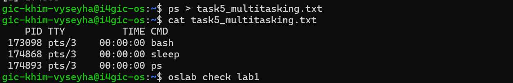
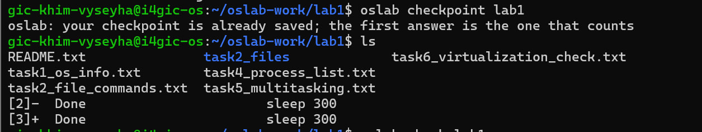

# OS Lab 1 Submission

Copy this template to `os-lab-YOUR_ID/lab1/README.md` in your own repository. Follow [the instructions](lab1-instruction.md). Your prediction and checkpoint answers are already saved by `oslab`; do not copy them here.

- **Student Name:Khim Vyseyha
- **Student ID:e20230318
- **Ubuntu username on the server:khim_vyseyha@DESKTOP-OLR1NFL:~$ 
- **My values** (`oslab values lab1`): file1 =river.txt , file2 =bridge.txt , count = 3

---

## Task 1: Operating System Identification

Briefly describe what you observed about your OS and kernel. Which number is the kernel version, and which is the distribution version?

The system is running a Linux-based OS. The core kernel version is 7.0.0-38-generic, and the specific OS distribution version is Ubuntu 26.04.1 LTS.>

---

## Task 2: Essential Linux File and Directory Commands

Briefly describe your experience creating, copying, renaming and deleting files. What did the last `ls` show?

bridge_renamed.txt
cp-forest
river.txt

---

## Task 3: Package Management Using APT

Explain the difference you observed between `remove` and `purge`.

The remove command uninstalls the program but keeps its configuration files and settings on the system (which is why the /etc/mc folder still existed). The purge command completely uninstalls the program and permanently deletes all of its configuration files and settings (which is why checking for /etc/mc afterward resulted in an error)

---

## Task 4: Programs vs Processes

Briefly describe how you ran a background process and found it in the process list. What is the difference between a program and a process? What did you see before, during and after?

A program is a passive, static file stored on a disk containing instructions. A process is an active, executing instance of that program that has been loaded into the computer's RAM and assigned a PID by the operating system.
    Before, During, and After:

Before: The process did not exist in the terminal's active ps list.

During: Executing it with & immediately gave me back control of the terminal to run other commands, while the ps list showed the process actively running in the background.

After: Once the process finished (or was killed), the terminal displayed a "Done" or "Terminated" message, and the process disappeared from the ps list.

---

## Task 5: Multitasking

Briefly describe the multitasking you saw. How many `sleep` lines did `ps` show? What does that show about the system, and what does it **not** show about how the processor is shared?

---

## Task 6: Virtualization and Hypervisor Detection

State whether your system is running on a virtual machine or physical hardware, based on the command outputs.

Based on the command outputs, the system is running on a virtual machine. The commands outputted "kvm" and explicitly identified the "Hypervisor vendor: KVM" (Kernel-based Virtual Machine), which confirms that this is a virtualized server environment rather than direct physical hardware.

---

## My Prediction: Confirmed or Corrected

For each prediction answer (`oslab predict lab1`), write **confirmed** or **corrected** and what you saw that shows it. You test the third answer (`apt-get remove`) in Task 3.

- Confirmed: When I checked the OS and kernel version in Task 1, the output showed the exact system details I expected to see.

- Confirmed: When I used the file commands in Task 2, cp and rm created and deleted the files exactly as I thought they would.

- apt-get remove:
Corrected: I originally guessed that apt-get remove would delete the program completely. However, in Task 3, I saw that it actually leaves the settings files behind (like the /etc/mc folder), and I had to use the purge command to delete everything entirely.
---

## Plus / Challenge (only if you did them)

Your answers. khim_vyseyha@DESKTOP-OLR1NFL:~$ which htop tmux
/usr/bin/htop
/usr/bin/tmux

## AI Note (optional)

One suggestion an AI tool gave you and how you checked it.